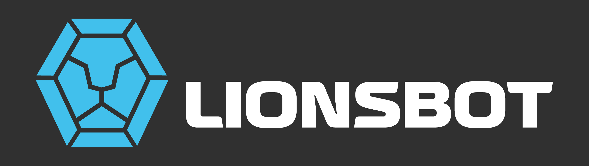

# LionsBot Open-RMF Fleet Adapter


This repository connects LionsBot robots to [Open-RMF](https://www.open-rmf.org/). It has a setup tool that turns a LionsBot robot map into an RMF map, an RMF launch stack, and the fleet adapter that talks to the LionsBot API.

| Ubuntu | ROS | Robots |
| --- | --- | --- |
| 24.04 | ROS 2 Jazzy | R3 (Vac, Scrub Pro), R5. REX: testing in progress |

> **Upgrading from v1.x?** LeoScrub robots are no longer supported as of v2.0.0, and the `fleet_adapter_r3` and `fleet_adapter_leoscrub` packages are replaced by one `fleet_adapter` package. Deployments with LeoScrub fleets should stay on [v1.1.2](https://github.com/lionsbot-official/fleet_adapter_lionsbot/releases/tag/v1.1.2).

## Contents

1. [Before you start](#1-before-you-start)
2. [Set up a site with one level](#2-set-up-a-site-with-one-level)
3. [Add more levels and lifts](#3-add-more-levels-and-lifts)
4. [Join an RMF that someone else runs](#4-join-an-rmf-that-someone-else-runs)
5. [Reference](#5-reference)
6. [FAQ and troubleshooting](#6-faq-and-troubleshooting)
7. [Future improvements](#7-future-improvements)

Follow sections 1 and 2 in order. Do section 3 only for a robot that works on more than one level.

## 1. Before you start

You need:

- A LionsBot account (email and password) that can see your robot, and the API address of your region, for example `https://api.lionsbot.io`.
- The robot online in the LionsBot cloud, with a robot map that already has its dock, named points and cleaning zones. You make these on the robot with the LionsBot tools, not here.
- Ubuntu 24.04 with internet access to the LionsBot API.

Install the software once:

1. ROS 2 Jazzy: follow the [ROS 2 Jazzy installation guide](https://docs.ros.org/en/jazzy/Installation.html).
2. Open-RMF, traffic editor and Cyclone DDS:

   ```bash
   sudo apt install ros-jazzy-rmf-dev ros-jazzy-rmw-cyclonedds-cpp python3-pip
   sudo rosdep init
   rosdep update
   python3 -m pip install --break-system-packages nudged==0.3.1
   ```

   `sudo rosdep init` fails when it was run before. That is fine.
3. [Docker Engine](https://docs.docker.com/engine/install/ubuntu/), not Docker Desktop. RMF Web runs in Docker with host networking.
4. This repository and your credentials:

   ```bash
   git clone https://github.com/lionsbot-official/fleet_adapter_lionsbot.git
   cd fleet_adapter_lionsbot
   cp fleet_adapter/.env.example fleet_adapter/.env
   ```

   In `fleet_adapter/.env`, set `LIONSBOT_USER`, `LIONSBOT_PASSWORD` and `LIONSBOT_API_BASE_URL`.
5. Check the login. Run every command in this guide from the repository folder.

   ```bash
   python3 tools/lb_rmf_setup/lb_rmf_setup.py --env-file fleet_adapter/.env auth check
   ```

   It prints your login. If it fails, see [Setup tool errors](#setup-tool-errors).

## 2. Set up a site with one level

### Words

| Word | What it is |
| --- | --- |
| Robot map | The map that the robot made and drives on. It lives in the LionsBot cloud with its docks, named points and cleaning zones. |
| Building file | `fleet_adapter/maps/<building>/rmf_<building>.building.yaml`. The RMF map. You draw it in traffic editor on top of a floor plan image. It holds the levels, walls and lanes. |
| Nav graph | `fleet_adapter/maps/<building>/0.yaml`. The lanes of the building file, in metres. `run_fleet.sh` makes it each time it starts. |
| Fleet config | `fleet_adapter/configs/<building>/config_<type>.yaml`. The robots of one fleet and their settings, including `map_transform`, which lines up the robot map with the building file. |
| Approach point | The named point that the robot map keeps in front of a dock, facing it. The robot drives from it onto the dock. |

In the commands, replace:

- `<building>`: a folder name for your site, for example `pdd_office`
- `<robot>`: the robot serial, for example `R3VAC-B00218`
- `<level>`: the RMF name of the floor, for example `L8`
- `<robot_map>` and `<robot_map_level>`: the name and level of the robot map, from `maps list`

To keep the commands short, set these in your terminal. In a new terminal, set them again, and `CONFIG` from step 2 too.

```bash
S="python3 tools/lb_rmf_setup/lb_rmf_setup.py --env-file fleet_adapter/.env"
BUILDING=fleet_adapter/maps/<building>/rmf_<building>.building.yaml
```

### Steps

1. **Find the robot and its map.**

   ```bash
   $S robots list | grep <robot>
   $S maps list --robot <robot>
   ```

   `robots list` shows every robot your account can see, so `grep` finds yours. Note the name and level of the robot map for this floor. If you are not sure which map the robot uses, leave out `--map-name` and `--map-level` in step 2: `init` then takes the map that the robot uses now.

2. **Write the fleet config.**

   ```bash
   $S init --robot <robot> --building <building> \
     --map-name <robot_map> --map-level <robot_map_level> --level <level>
   ```

   Its first `wrote` line is the path of the config. Keep that path:

   ```bash
   CONFIG=<path of the config>
   ```

   `init` also makes the folder `fleet_adapter/maps/<building>/` and sets `FOLDER_NAME`, `FLEET_1_CONFIG`, `FLEET_1_NAV_GRAPH` and `RMF_FLOOR_NAME` in `.env`. The map transform and the charger stay as placeholders. Step 5 fills them in. Add `--dry-run` to see the result without writing.

3. **Download the robot map image.** It is the floor plan in traffic editor.

   ```bash
   $S maps fetch --robot <robot> --map-name <robot_map> --map-level <robot_map_level> \
     --out fleet_adapter/maps/<building>/
   ```

   It writes `<robot_map>.png`, `<robot_map>.yaml` and `<robot_map>.geometry.json`.

4. **Draw the building file in traffic editor.**

   ```bash
   source /opt/ros/jazzy/setup.bash
   traffic-editor
   ```

   The toolbar buttons show their names when you point at them, for example **Add Wall (W)**.

   1. **Building, New...**. In the file dialog, go to `fleet_adapter/maps/<building>/` and save as `rmf_<building>.building.yaml`. In the next dialog, keep the name and choose **Reference-image coordinates**.

      

   2. In the **levels** tab on the right, select **Add...**. Set `name` to `<level>`, `elevation` to `0`, and `drawing` to `<robot_map>.png`. Type the file name only: the image is in the same folder as the building file. The setup tool knows from this name that the floor plan is the robot map. (The screenshot shows another site.)

      

   3. With **Add Measurement (T)**, click two points far apart, for example the two ends of a long wall. With **Select (Esc)**, click the measurement. The Properties panel shows **length (m)**. Type that number in **distance** when `resolution` in `<robot_map>.yaml` is `0.05`, because traffic editor starts a level at 0.05 m per pixel. For another resolution, type length (m) × resolution / 0.05, or the real length when you know it. **Building, Save**, close traffic editor and open it again (**Building, Open...**). The level now has its scale.

      

   4. With **Add Wall (W)**, draw at least one wall. RMF Web needs it to show the map.

      

   5. **Building, Save**. Do not draw the docks or named points. Step 5 adds them.

5. **Add the robot map points.** First look, then write:

   ```bash
   $S export --building $BUILDING --config $CONFIG --level <level> --dry-run
   $S export --building $BUILDING --config $CONFIG --level <level>
   ```

   It adds each dock, named point and cleaning zone start of the robot map to the building file, draws the lane from each approach point to its dock, writes the cleaning paths to `dock_summary.yaml`, and fills in `charger.waypoint` and `map_transform` in the config. It prints `map transform: <level> from the measurements of <level>, whose floor plan is the robot map`. Run it again after any change to the robot map. A second run changes only what changed.

6. **Draw the lanes in traffic editor.** Open the building file again. With **Add Lane (L)**, join the approach points, the named points and the cleaning zone starts into the routes that the robot may drive. Start and end each lane exactly on a vertex: a click next to a vertex makes a new vertex, and the lane then misses the point. Keep vertices a little away from walls. Do not draw another lane to a dock. Save.

     

7. **Check the building file and the config.**

   ```bash
   $S check --building $BUILDING --config $CONFIG
   ```

   It names each lane that misses a vertex, each named point with no lane, each stray vertex, each name used on more than one level, and a robot without a charger. Fix them in traffic editor and run it again until it prints `no problems found`.

8. **Set where the robot starts.** When the robot is not localized when the adapter starts, the adapter **undocks the robot** and localizes it at `rmf_config.start.localization_starting_point` in the config. `init` leaves it at `0, 0, 0`. Set it to a point on the robot map: `x` and `y` in pixels of the robot map image and `heading` in radians, the same numbers as the points in `<robot_map>.geometry.json`. For example, copy `x`, `y` and `angle` of the point that `export` named in `dock: <dock> is reached from <point>`.

9. **Start RMF.** In one terminal:

   ```bash
   cd fleet_adapter
   ./run_fleet.sh
   ```

   It builds the package, checks the network, makes the nav graph, runs `check` again, then starts RMF, RViz and RMF Web. It can ask for your `sudo` password, for `rosdep` and for Docker. Keep it running.

   RViz shows the whole building in 3D. Every level is at its elevation, with its floor plan, walls, lanes and name. Each lift has a shaft and a car. The car moves to the floor that the lift reports and is green with open doors, red with closed doors. Each robot is on its level with a heading arrow, its name, a trail of where it was, and a colour for what it does (grey idle, blue moving or on a task, green cleaning, purple docking, yellow charging, red error). Planned paths are drawn for the level in `RMF_FLOOR_NAME`.

10. **Start the adapter.** In a second terminal:

    ```bash
    cd fleet_adapter
    ./run_fleet_adapter.sh 1
    ```

    The `1` selects `FLEET_1_CONFIG` and `FLEET_1_NAV_GRAPH` in `.env`. The adapter is ready when its log shows `Successfully added new robot`.

11. **Send a task.** Open RMF Web at http://localhost:3000. To clean, select **New Task**, then the task **Clean**, and pick a **Cleaning Zone**.

To stop, press `Ctrl+C` in each terminal. After any change to the building file, stop and start `run_fleet.sh` and the adapter. RMF and RMF Web read the map only when they start.

## 3. Add more levels and lifts

RMF needs one building file with all levels, and one fleet config with the robot map of each level. The robot starts on the level of section 2. Each other level is added next to it.

### Before you start

On the LionsBot side, each level has its own robot map. For a lift:

- Each robot map of a level that the lift serves has the lift, with the same lift name on every level.
- The robot map of each level has a point with the name of the lift, inside the car: the cabin point.
- Any other point name must not repeat on another level. RMF refuses a nav graph with a repeated waypoint name (`Duplicated waypoint name`). Rename the points on the robot map, for example `l7_dock` on level 7. Lift and lobby points are the exception: the setup tool does not export them as waypoints.
- LionsBot must enable lift commands on the robot.

### Steps

Do these for each extra level, here `<level2>` with robot map `<robot_map2>` and level `<robot_map2_level>`.

1. **Download the robot map image** of the level, as in section 2 step 3.

2. **Add the level in traffic editor.** In the **levels** tab, select **Add...**. Set `name` to `<level2>`, `elevation` to its height in metres above the first level (negative for a lower floor), and `drawing` to `<robot_map2>.png` (file name only). RMF uses the elevation to order the floors of a lift, so a rough value in the right order is enough. Draw a measurement and a wall on it, as in section 2 step 4.

3. **Add fiducials.** On every level, with **Add Level Alignemnt Fiducial** (spelled so in traffic editor), add two fiducials at the same real places, for example two corners of the lift shaft. With **Select (Esc)**, click each one and type its `name` in the Properties panel. Use the same two names on every level. RMF uses them to line up the levels. Without them, the nav graph of every level except the first is in pixels, not metres. Save.

4. **Add the level to the config.** In `$CONFIG`, add two entries. Do not add a second `map_transform:` or `robot_maps:` key: put the new lines under the one that is there.

   Under `map_transform:` at the top, the level with a placeholder scale:

   ```yaml
   map_transform:
     <level>:
       ...
     <level2>:
       transform_values:
         rotation_degrees: 0.0
         scale: <metres_per_pixel>
         tx_meters: 0.0
         ty_meters: 0.0
   ```

   Under `rmf_config:` of the robot, next to `start:`, the robot map of the level. The config already has these lines as a comment after `start:` (`# robot_maps:`). Delete the `# ` at the start of the four lines and fill them in:

   ```yaml
   robots:
     <robot>:
       ...
       rmf_config:
         ...
         start:
           ...
         robot_maps:
           <level2>:
             name: <robot_map2>
             level: <robot_map2_level>
   ```

   Without the first, `export` stops with `the config has no map_transform.<level2>.transform_values`. Without the second, it stops with `no robot in the config is on <level2>`.

5. **Add the points of the level:**

   ```bash
   $S export --building $BUILDING --config $CONFIG --level <level2>
   ```

   Besides the points and the map transform, it writes `level_transform` for the level from the fiducials and prints `level transform: <level2> from 2 fiducials shared with the reference level <level>`. The reference level is the first level in the building file. `export` stops when the levels share fewer than 2 fiducial names, or when the fiducials turn the floor plan against the reference level, and says what to fix.

When every level is in, add the lifts and finish:

6. **Add the lifts.** Give every level that a lift serves:

   ```bash
   $S lifts export --building $BUILDING --config $CONFIG --level <level> --level <level2> \
     --lift-cabins --lift-approach --dry-run
   $S lifts export --building $BUILDING --config $CONFIG --level <level> --level <level2> \
     --lift-cabins --lift-approach
   ```

   It writes the `lifts:` block, and on each level a cabin vertex `<lift>_<level>_cabin` inside the car, an approach vertex `<lift>_<level>_approach` in front of the door, and a lane between them. It takes the car depth from a point `<lift>_door` on the robot map when there is one, otherwise from the car width, and says so. It stops and writes nothing when a lift has no cabin point on a level, when the cabin points of one lift are more than 0.1 m apart across levels, when another vertex is inside a car, or when a lift has no width.

7. **Draw the lanes** on every level, as in section 2 step 6. Join each `<lift>_<level>_approach` vertex to the routes. Then run `check` as in section 2 step 7.

8. **Turn on lift commands.** In `$CONFIG`, change `lift_commands: false` under `experimental:` to `lift_commands: true`.

   With `false`, the adapter never moves the robot into or out of a lift car. It fails that move and, outside the car, RMF cancels the task.

9. **Start RMF and the adapter** as in section 2 steps 9 and 10. A lift trip also needs a lift adapter (see [below](#a-lift-trip-needs-a-lift-adapter)). With no real lift, set `MOCK_LIFTS=true` in `.env` before you start `run_fleet.sh`.

10. **Send the robot to the other level.** In a third terminal, from the repository folder:

    ```bash
    source /opt/ros/jazzy/setup.bash
    set -a; source fleet_adapter/.env; set +a
    ros2 topic pub --once --qos-durability transient_local --qos-reliability reliable \
      /task_api_requests rmf_task_msgs/msg/ApiRequest \
      "{request_id: lift_test_1, json_msg: '{\"type\": \"dispatch_task_request\", \"request\": {\"category\": \"patrol\", \"description\": {\"places\": [\"<waypoint>\"], \"rounds\": 1}}}'}"
    ```

    `<waypoint>` is a named point on the other level. Use a new `request_id` for each task.

### A lift trip needs a lift adapter

RMF moves the lift through a lift adapter of the site. The fleet adapter never calls the lift. It only moves the robot. What RMF needs:

- The RMF `lift_supervisor` node. It passes the lift requests of a fleet adapter (`adapter_lift_requests`) on to the lift adapter (`lift_requests`). `run_fleet.sh` starts it. On an RMF that someone else runs, `ros2 node list` must show `/rmf_lift_supervisor`.
- A lift adapter that reads `lift_requests` and publishes `lift_states` for each lift, at least one time in 10 seconds. `current_floor` is the RMF level name. `session_id` is the session of the request that holds the lift. For a robot it is `<fleet name>/<RMF robot name>`, for example `lb_fleet/R3VAC_B00218`. While the lift waits for the robot, `door_state` is `2` (open) and `motion_state` is `0` (stopped).
- The same lift name in the building file, in the lift adapter and on the robot map of each level.

**No real lift?** In `.env`, set `MOCK_LIFTS=true` before you start `run_fleet.sh`. It then starts a mock lift adapter that moves no real lift: it reads the lifts from the building file, answers the lift requests of RMF, "moves" for 3 seconds with closed doors, then reports open doors. Its output shows `This is a mock lift adapter`, and one `MOCK lift` line for each change. Watch it with `ros2 topic echo /lift_states`. Use it only where no real lift adapter runs. The robot is real: keep the lift point clear, because the robot drives in when the mock reports open doors.

To check the whole chain on one machine with no robot, run `tools/lift_e2e/run.sh`. It starts RMF with the mock lift adapter on `ROS_DOMAIN_ID` 58 and the adapter with a fake robot, sends the robot to another level and back, and checks each step.

## 4. Join an RMF that someone else runs

Use this when the site already runs its own RMF core and RMF Web. Do not run `run_fleet.sh` there. It starts a second RMF core.

1. Ask the site for its building file and level names, and put the file in `fleet_adapter/maps/<building>/`. Do sections 1 and 2 up to step 8 on it, but skip drawing the level (section 2 step 4): add your robot map image to each level as a layer, as in [Another floor plan than the robot map](#another-floor-plan-than-the-robot-map), so `export` places the points in the frame of the site.
2. Build the adapter and make the nav graph:

   ```bash
   cd fleet_adapter
   source /opt/ros/jazzy/setup.bash
   rosdep install --from-paths . --ignore-src -r -y
   colcon build --symlink-install
   ros2 run rmf_building_map_tools building_map_generator nav \
     maps/<building>/rmf_<building>.building.yaml maps/<building>/
   ```

3. In `.env`, set `ROS_DOMAIN_ID` and `RMW_IMPLEMENTATION` to the values of the site, and `SERVER_URI=ws://<host>:<port>/_internal` to the RMF Web API server of the site. It must listen on an address that your machine can reach. Give `rmf_fleet.name` in the config a name that no other fleet on the site uses.
4. Make sure the robot is localized, then run `./run_fleet_adapter.sh 1`. The adapter has joined the RMF of the site when its log shows `Mirror handling new sync`.

## 5. Reference

### What the adapter does at a lift

One trip from level A to level B, with `lift_commands: true`:

| Step | RMF | Adapter |
| --- | --- | --- |
| 1 | Moves the robot to the approach vertex on level A. | Sends a point-to-point move. |
| 2 | Requests the lift to level A and waits for the car and the open doors. | Does nothing. |
| 3 | Moves the robot to the cabin vertex. | Checks the lift state, then sends `lift_enter_start`. |
| 4 | Requests the lift to level B. | Does nothing. |
| 5 | Asks for the robot position on level B. | Changes the robot map to level B and sets the robot pose at the cabin vertex. |
| 6 | Moves the robot to the approach vertex on level B. | Checks the lift state, then sends `lift_exit_start`. |
| 7 | Ends the lift session. | Does nothing. |

Safety rules:

- It sends a lift command only when the latest lift state, not older than 10 seconds, shows the car at the level of the robot, open doors, a stopped car, and the session of this robot. It waits 10 seconds for this state.
- During a lift move, it stops the robot when the car moves or when the lift session changes.
- It does not stop a lift move when RMF cancels the task, so the robot does not stay in the doorway.
- It stops the robot when the robot sends no result in 6 minutes.
- A robot in a lift car leaves it only with `lift_exit_start`.

When a lift move fails, the adapter never tells RMF that the robot arrived, so RMF does not move the car. When the robot did not move, the adapter asks RMF for a new plan, up to `navigation.max_retries` failures in a row. After that, or when the robot moved, the robot stays where it is and the reason goes to the adapter log and the RMF task log. Check the robot and the lift, then cancel or restart the task.

When lift commands are not enabled on the robot, the command fails after 15 seconds with reason code `RCSE00006` (`RCSE00005` for a robot model without lift commands). The adapter cancels the task, so RMF releases the lift, and sends that robot no more lift commands until the adapter starts again. The robot can still work on its current level.

The adapter stops at start when `experimental` is not a mapping, has an unknown key, or `lift_commands` is not `true` or `false`.

### Robot faults

When a robot reports `Estop`, `Error` or `Offline`, the adapter opens an RMF issue on the robot and sends one RMF Web alert. A clean or dock action in progress is marked blocked, or delayed for `Offline`. `Offline` counts only after it lasts `navigation.timeout_grace_sec`. When the state ends, the issue is resolved. The adapter sends the robot no command because of these states.

### Settings in `.env`

| Setting | Use |
| --- | --- |
| `LIONSBOT_USER`, `LIONSBOT_PASSWORD`, `LIONSBOT_API_BASE_URL` | LionsBot login and API address. |
| `FOLDER_NAME` | The site folder under `maps/` and `configs/`. Set by `init`. |
| `FLEET_<n>_CONFIG`, `FLEET_<n>_NAV_GRAPH` | Config file and nav graph of fleet `<n>`, started with `./run_fleet_adapter.sh <n>`. Set by `init` (`--fleet-number` for another fleet). Remove the lines of a fleet that you do not have. |
| `RMF_MAP_NAME` | Only when the building file is not `rmf_<FOLDER_NAME>.building.yaml`. |
| `RMF_FLOOR_NAME` | The level that RViz shows first. Set by `init`. |
| `MOCK_LIFTS` | `true` starts the mock lift adapter. |
| `ROS_DOMAIN_ID`, `RMW_IMPLEMENTATION` | Must be the same for RMF and every adapter. Default `0` and `rmw_cyclonedds_cpp`. The RMF Web of `run_fleet.sh` always uses domain `0`. |
| `CYCLONEDDS_URI` | Optional Cyclone DDS config, for example to pick a network card. |
| `SERVER_URI` | The RMF Web API server, `ws://<host>:<port>/_internal`. `wss://` does not work with the RMF client in ROS 2 Jazzy. |
| `SCHEDULE_TIMEOUT` | Seconds the adapter waits for the RMF traffic schedule. Default 60. |
| `RMF_WEB_API_TOKEN`, `RMF_WEB_ALERTS_URL` | Optional. Without the token, the adapter sends no alerts to RMF Web. The URL defaults to the server of `SERVER_URI`. |

### Setup tool

Every command takes `--help`. Put `--json` (one JSON result, also on failure) or `--verbose` (each API call, no secrets) before the command, for example `$S --verbose maps list --robot <robot>`. `export` and `lifts export` take `--dry-run` (print the diff, write nothing) and `--check` (exit 10 when the files would change). `maps fetch` never replaces a file without `--overwrite`. `export --from-geometry <file>` works from a `.geometry.json` file that `maps fetch` wrote, with no network.

Rules of `export`: a vertex is matched by its name. A new name is added at the end. No vertex is deleted or reordered, so your lanes stay. An existing vertex keeps its position (`--update-positions` moves it). When a dock has no approach point on the robot map, `export` adds `<dock>_approach` 0.7 m in front of it. Values that you set by hand in the config never change.

#### Setup tool errors

| Exit code | Meaning |
| --- | --- |
| 0 | Success |
| 2 | Wrong command line |
| 3 | A local file or variable is missing or wrong |
| 4 | Login refused: check the email, password and API address |
| 5 | No access to the robot or map |
| 6 | API or network error. `429` means too many requests: wait a minute and run it again |
| 7 | Robot map data error, also when the map is not synced to the robot yet |
| 8 | Lift data error |
| 9 | `check` found problems |
| 10 | The files would change (`--check`) |

### Another floor plan than the robot map

You can draw on another floor plan, for example an architect's drawing. Then add the robot map image as a second layer in the **layers** tab, set its scale to about 0.05, move and turn it near the floor plan, draw constraint pairs on matching features of both, and press `Ctrl+T` to align. Name the layer image `<robot_map>.png`, or keep it in a folder named after the robot type. `export` then takes the layer transform. A floor plan of another level that is turned against the first level is not supported (see `level_transform` in [`config_template.yaml`](fleet_adapter/configs/config_template.yaml)).


### Run with Docker

The Docker setup in [`fleet_adapter/docker/`](fleet_adapter/docker/) runs the adapter only. Keep `run_fleet.sh` running for RMF and RMF Web.

```bash
cd fleet_adapter
set -a; source .env; set +a
FLEET_CONFIG="$FLEET_1_CONFIG" NAV_GRAPH="$FLEET_1_NAV_GRAPH" \
  sudo -E docker compose -f docker/docker-compose.yaml up --build
```

Follow its log with `sudo docker logs -f docker-fleet-adapter-1`.

### Repository

```text
fleet_adapter/
├── configs/<building>/      Fleet configs. config_template.yaml is the template
├── maps/<building>/         Building file, nav graphs, dock_summary.yaml, robot map images
├── fleet_adapter/           Python adapter package
├── launch/                  RMF launch file, RMF Web compose file, network check
├── docker/                  Adapter-only container
├── run_fleet.sh             Builds and starts RMF, RViz and RMF Web
└── run_fleet_adapter.sh     Starts one fleet adapter
tools/lb_rmf_setup/          The setup tool
tools/lift_e2e/              End-to-end lift test with a fake robot
```

`fleet_adapter/office_new` is LionsBot's own example site. Its configs name LionsBot's robots.

## 6. FAQ and troubleshooting

### The adapter says `Adapter.make() returned no adapter`

It found no RMF traffic schedule in `SCHEDULE_TIMEOUT` seconds. Make sure RMF runs, and that `ROS_DOMAIN_ID` and `RMW_IMPLEMENTATION` in `.env` are the values of that RMF. If they are, the ROS 2 nodes cannot find each other. Run:

```bash
python3 fleet_adapter/launch/check_network.py
```

It finds the two usual causes and prints the fix: a firewall that drops multicast (with ufw, for example `sudo ufw allow in on wlp0s20f3 to 239.255.0.1`), or a VPN that takes all traffic. After the fix, stop and start `run_fleet.sh` too.

### The robot does not go onto the dock, or it says "Destination inaccessible"

Run `check`. The usual cause is a lane that ends on a new vertex next to the dock or its approach point, not on the point itself. Each dock needs only the lane from its approach point, which `export` draws.

### RMF Web does not show my new waypoint

RMF and RMF Web read the building file only when they start. Save it, then stop and start `run_fleet.sh` and the adapter. A waypoint also needs a name and a lane.

### RMF shows my robot under another name

A ROS 2 name allows only letters, digits and underscores, so `R3SCP-B02357` becomes `R3SCP_B02357` in RMF. Use the RMF name in RMF Web and in task requests. To choose it, set `robot_config.rmf_name` in the config.

### RMF or adapter processes are left over

```bash
ps -ef | grep -E '[r]os2 launch|[r]mf_|[f]leet_adapter'
```

Stop each one with `kill <PID>`. If it is still there after a few seconds, use `kill -9 <PID>`.

## 7. Future improvements

- Map LionsBot vendor error codes, beyond `Estop`, `Error` and `Offline`, to the RMF call that fits. `replan()`, `interrupt()` and `set_commission()` are not used yet. In `rmf_adapter` 2.7.2 for Python, only the execution of an action has `delayed`, `blocked` and `error`. A navigation command has none.
- Network security for a deployment: the [Open-RMF deployment template](https://github.com/open-rmf/rmf_deployment_template) shows Kubernetes, an ingress, Keycloak and TLS for the users of RMF Web, and a bridge such as Zenoh for networks that are not trusted. Keep `SERVER_URI` and DDS traffic on a trusted network.
- A level whose floor plan is turned against the first level, and the same waypoint name on two levels.
- Lift commands out of the experimental features, after tests on real lifts.
- RMF Web runs a scheduled task with the same dispatch as a task that you send now, so the adapter needs no change. Its scheduler uses the `timezone` setting of the RMF Web API server, `UTC` by default. Not yet run on a real robot.
